# Make C: bigger by taking space from D: (one SSD, Windows 11, no reinstall)

Created 2026-10-14. Rewritten the same day after two full test runs; see [Test evidence](#test-evidence).

This guide is written so you can follow it without knowing anything about partitions. Do the steps in order, compare your screen with the pictures, and don't skip the checks.

**What you'll end up with:** C: is bigger, D: still has all its files and is still called D:, and Windows' repair tools (the Recovery partition) still work.

**Time:** about 1 hour, plus copying time. Copying runs at about 1–2 GB per second on a fast SSD, so 250 GB takes roughly 5 minutes, more with many small files.

## Contents

1. [Why this takes several steps](#why-this-takes-several-steps)
2. [Before you start](#before-you-start)
3. [Part 1: find out what is using D: and stop it](#part-1-find-out-what-is-using-d-and-stop-it)
4. [Part 2: the steps](#part-2-the-steps)
5. [If something goes wrong](#if-something-goes-wrong)
6. [Other methods (USB disk, partition tools)](#other-methods)
7. [Test evidence](#test-evidence)

## Why this takes several steps

Picture the disk as a bookshelf with boards side by side: C:, then a small Recovery board, then D:.

- Windows can only make C: longer into **empty space right next to it**.
- When you make D: smaller, Windows always cuts from the **far end** of D:, never from the side next to C:. Windows has no built-in way to slide D: along the shelf.
- The small Recovery board also sits in the way.

So we do it the other way round: we make D: smaller, build a new board at the far end, copy everything from D: onto the new board, and remove the old D: and the Recovery board. Now the empty space is next to C:, and C: can grow into it. Finally we put back a small Recovery board and give the new board the name D:.

```
start:     | EFI | C: 127 | Rec | D: 870 (your files)                         |
step 2:    | EFI | C: 127 | Rec | D: 300 (your files)  | empty 570             |
step 3-4:  | EFI | C: 127 | Rec | D: 300 (your files)  | E: 570 (copy)         |
step 5-6:  | EFI | C: 127 | empty 301                  | E: 570                |
step 7-8:  | EFI | C: 427                     | Rec 1 | E: 570                |
step 9:    | EFI | C: 427                     | Rec 1 | D: 570                |
```

The numbers are an example for a 1 TB SSD: C: 127 GB grows by 300 GB, D: holds 250 GB of files.

## Before you start

Tick off every item.

1. **Back up D:.** Copy your important files to an external disk or the cloud. The method below is tested, but a power cut or a click on the wrong drive can still cost you data.
2. **How full is D:?** Open File Explorer → *This PC*, right-click **D:** → *Properties*. Write down **Used space**. Call this number **U**.
3. **How much bigger should C: get?** Call this number **G**. This method works when **U is smaller than G**, with a few GB to spare. Example: U = 250 GB, G = 300 GB: fine. If U is bigger than G, read [Other methods](#other-methods) first.
4. **Is the disk GPT?** Right-click Start → **Disk Management**. Right-click the grey box **Disk 0** on the left → *Properties* → tab *Volumes*. *Partition style* must say **GUID Partition Table (GPT)**. That is normal on Windows 11. If it says *Master Boot Record (MBR)*, stop: the commands in steps 6 and 8 are written for GPT.
5. **BitLocker / Device encryption:** open *Settings → Privacy & security → Device encryption* (Windows 11 Home) or *Control Panel → BitLocker Drive Encryption* (Pro). If C: is encrypted: look up your recovery key first (https://aka.ms/myrecoverykey) and click **Suspend protection** for C:. Otherwise the PC may ask for that key after the changes.
6. Laptop: plug it into power.

### How to open the two tools you'll use

- **Disk Management:** right-click the **Start** button → **Disk Management**. Leave it open for the whole job. After you run a command in the terminal, click **Action → Refresh** in Disk Management.
- **Terminal (Admin):** right-click the **Start** button → **Terminal (Admin)** → **Yes**. On older Windows it's called *Windows PowerShell (Admin)*. The title bar must say *Administrator*.

**Pasting commands:** copy the gray command box from this guide, click inside the terminal window, and press **Ctrl+V**. If Windows asks whether you want to paste multiple lines, click **Paste anyway**. After a block of several lines, press **Enter** once more so the last line runs too.

## Part 1: find out what is using D: and stop it

Windows can only copy and delete D: properly when nothing has a file on D: open. Games, Steam, Epic, OneDrive, backup programs and virtual machines on D: keep files open. Do this check now, and again just before step 4.

### 1a. Close the programs

Close them in this order:

1. **The game.** Quit it from its own menu.
2. **Steam** (or Epic, GOG, Battle.net, …). Right-click its icon near the clock → **Exit**. No icon? Use Task Manager:
   - Press **Ctrl+Shift+Esc**.
   - Type `steam` in the search box at the top.
   - Click **Steam** and then **End task**. Do the same for anything else listed with the same name.

   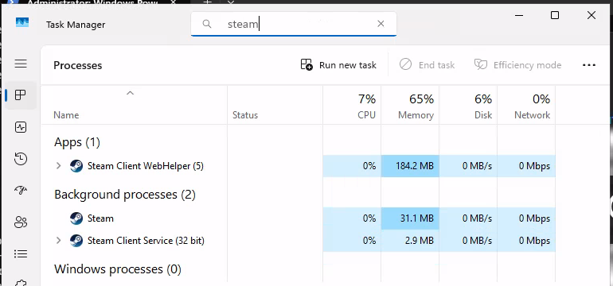

   In our test, ending **Steam** also stopped *Steam Client WebHelper* and *Steam Client Service*. If one of them is still listed, end it as well.
3. **OneDrive**, if its folder is on D:: click the cloud icon near the clock → gear → **Pause syncing** → **Quit OneDrive**.
4. Backup programs, virtual machines (VirtualBox, VMware), anything else you installed on D:.

### 1b. Check that nothing holds D: any more (Resource Monitor)

1. Press **Windows key + R**, type `resmon`, press **Enter**.
2. Click the **CPU** tab.
3. Open the section **Associated Handles**. In its search box type `D:\` and press **Enter**.

While something still uses D:, you see a list. Each line is a program (left) with a file on D: (right):

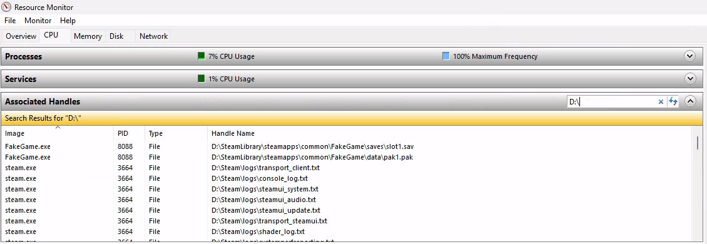

The **Image** column tells you which program to close. Close it, then click the search button again. You're done when the list is **empty**:

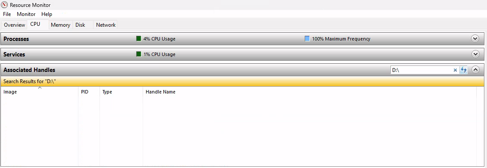

Things that may still show up:

- **A service** that restarts by itself (for example a game's anti-cheat or a backup agent). Press **Windows key + R**, type `services.msc`, find it, right-click → **Stop**. If it comes back, set *Startup type* to **Manual** for now and change it back afterwards.
- **Explorer, Windows Search or Windows Defender** sometimes briefly look at D:. Close all Explorer windows showing D: and wait a minute. These let go on their own.
- **A page file on D:** (rare). Move it in *System Properties → Advanced → Performance Settings → Advanced → Virtual memory*, then restart the PC.

### 1c. Optional: let a script check it for you

Resource Monitor is enough. If you want certainty, [`scripts/Test-DriveInUse.ps1`](scripts/Test-DriveInUse.ps1) lists programs and services running from D:, a page file on D:, and (if Sysinternals `handle64.exe` sits next to it) every open file. At the end it asks Windows for exclusive access to D:. Windows only grants that when truly nothing has D: open.

Save the script to, for example, `C:\Tools\`, then in **Terminal (Admin)**:

```
powershell -ExecutionPolicy Bypass -File C:\Tools\Test-DriveInUse.ps1 -DriveLetter D
```

In use (red line at the bottom, with a list of programs above it):

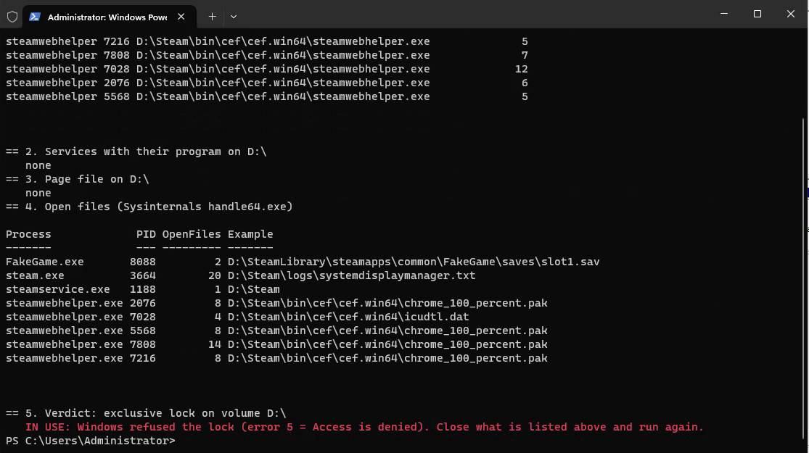

Free (green line):

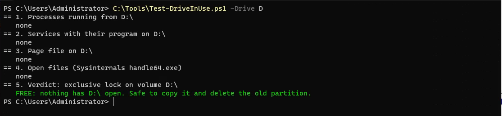

## Part 2: the steps

### Step 1: look at the disk

In **Disk Management**, look at the bar for **Disk 0** at the bottom.

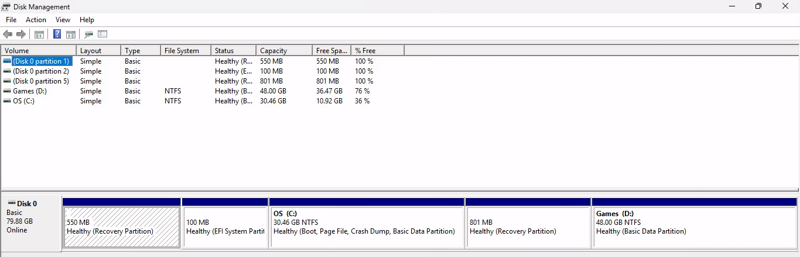

Look at the block **directly to the right of C:**.

- Does it say **Recovery Partition**? That's normal. You'll do steps 6 and 8.
- Is D: directly next to C:? Then skip steps 6 and 8.

(A second Recovery partition at the **start** of the disk, like the 550 MB one in the picture, is harmless. Leave it alone.)

Right-click **C:**. **Extend Volume…** is gray: there's no empty space next to C:. That's what we're fixing.

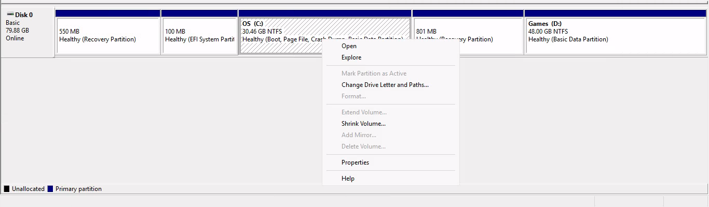

Right-clicking the Recovery partition only offers **Help**. That's why steps 6 and 8 use the terminal.

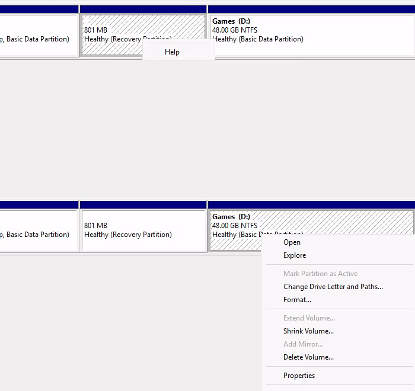

### Step 2: make D: smaller

1. Right-click **D:** → **Shrink Volume…**. Wait for the window.
2. At *Enter the amount of space to shrink in MB*, type the size of the **new** D:. It must be bigger than **U** (the used space on D:), with at least 10% to spare.

   Example (1 TB disk, D: 870 GB, 250 GB used, C: should grow 300 GB): the new D: becomes 870 − 300 = 570 GB. Type 570 × 1024 = **583680**.

   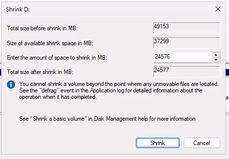

3. Click **Shrink**. A black block **Unallocated** appears at the far right of the disk.

   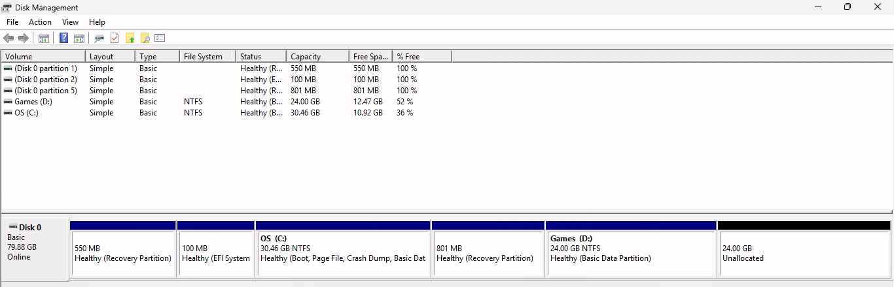

Windows offers less than you need? Turn off *System Protection* for D: (search Start for **Create a restore point** → select D: → *Configure* → *Disable protection*; this deletes D:'s restore points), then try again.

### Step 3: make the new drive at the end

1. Right-click the black **Unallocated** block → **New Simple Volume…** → **Next**.

   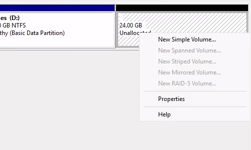

2. Size: leave the number as it is → **Next**.

   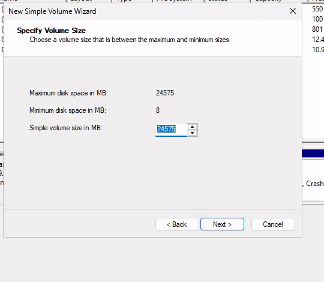

3. Drive letter: leave **E** (or any free letter) → **Next**. This guide calls it E:.

   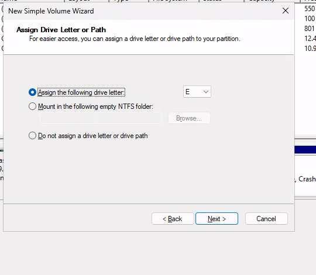

4. File system **NTFS**, *Volume label*: the same name D: has now (here `Games`), *Perform a quick format* ticked → **Next** → **Finish**.

   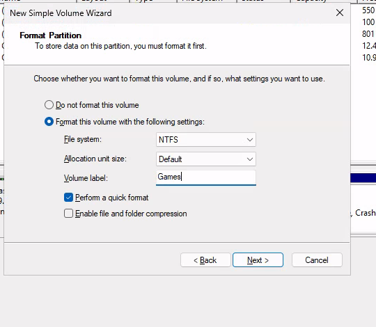

The new drive E: now sits at the end of the disk:

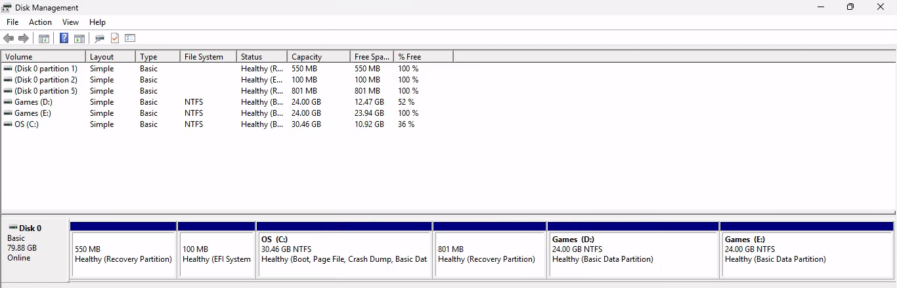

### Step 4: copy everything from D: to E:

You copy twice. The first copy does the bulk of the work. The second copy, with everything closed, only fills in the last few files and is the one that has to be perfect.

**First copy.** In **Terminal (Admin)** paste:

```
robocopy D:\ E:\ /MIR /COPYALL /DCOPY:DAT /R:1 /W:1 /XD "System Volume Information" "*RECYCLE.BIN" /NP /NFL /NDL
```

This copies all files, hidden files included, with their permissions and dates. It skips two Windows system folders that every drive has.

If something still had a file open, you see `ERROR 32 ... The process cannot access the file because it is being used by another process`, and the **FAILED** column in the summary shows a number above 0:

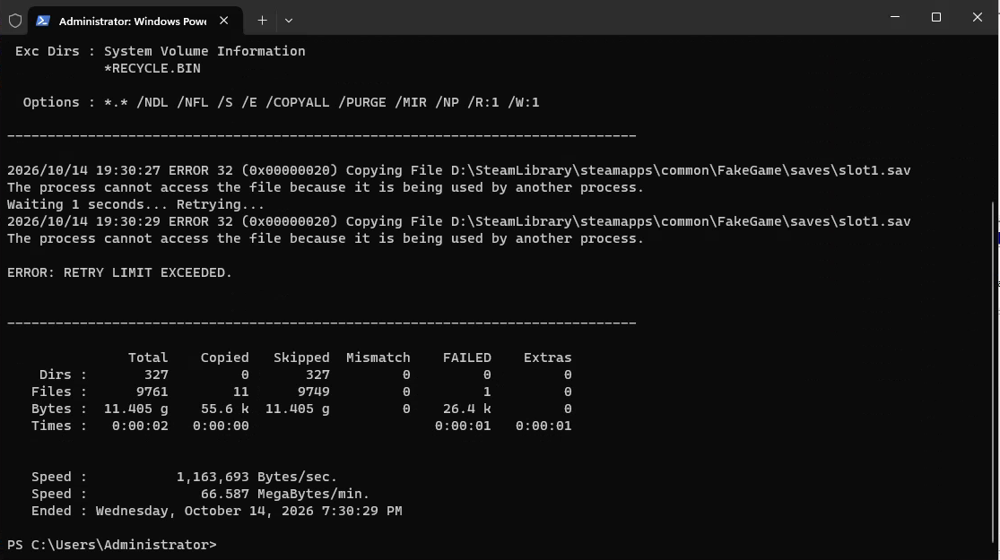

That's expected if a program was still running. The error line shows which file and folder; that tells you which program to close.

**Second copy.** Do [Part 1](#part-1-find-out-what-is-using-d-and-stop-it) again until Resource Monitor shows an empty list. Then press **↑** in the terminal and **Enter** to run the same command again. It only copies what changed, so it's quick.

**Check the summary.** In the lines `Dirs :` and `Files :` the **FAILED** column must be **0**:

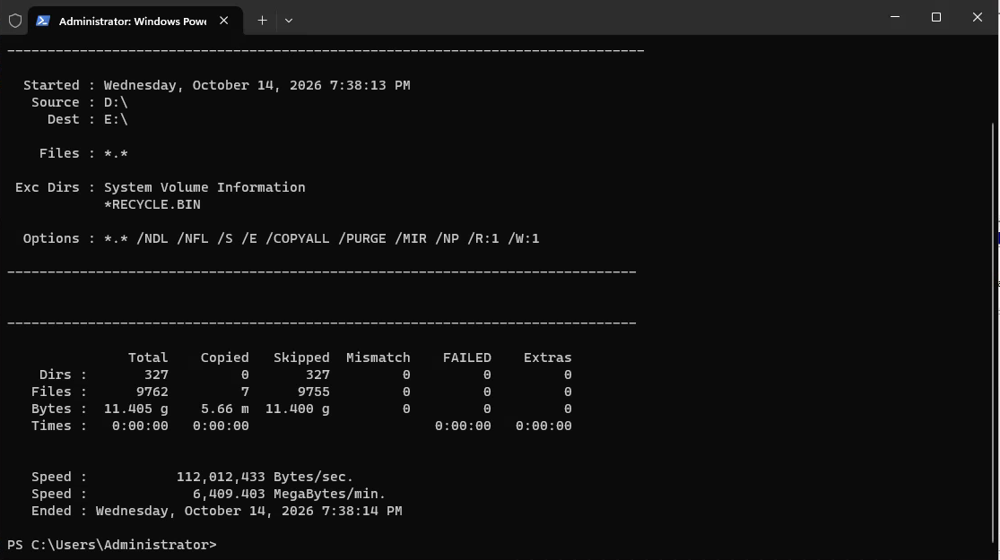

Not 0? Don't continue. Find which program still holds D: (Part 1) and run the command again.

Last check by eye: open E: in File Explorer, open a few photos or documents, and compare *Properties* of D: and E:: the **Used space** should be about the same.

### Step 5: delete the old D:

Only when step 4 ended with **FAILED 0**.

1. In Disk Management, right-click **D:** → **Delete Volume…**

   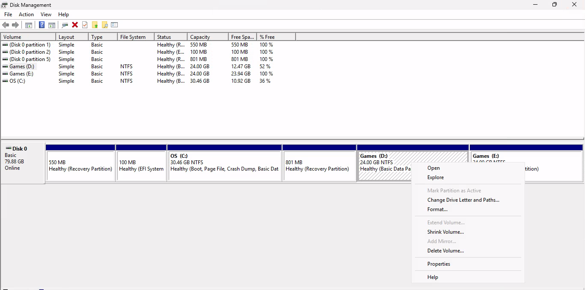

2. Click **Yes**.

   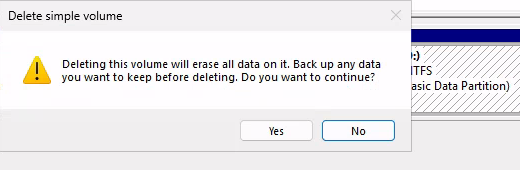

Where D: was, there's now a black **Unallocated** block:

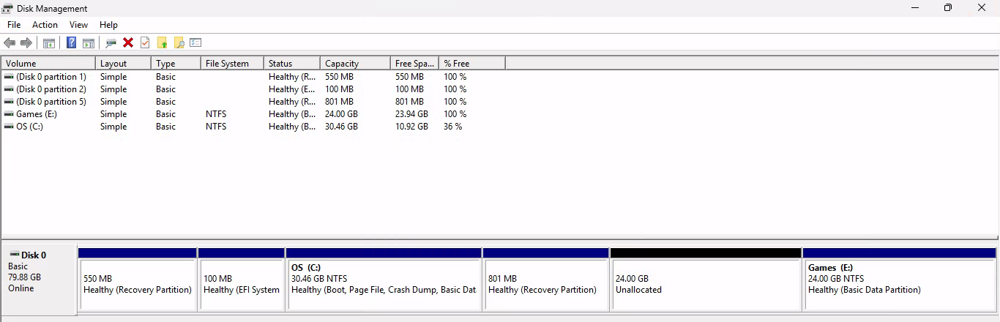

### Step 6: remove the Recovery partition next to C: (paste block 1)

Skip this if in step 1 there was no Recovery partition directly right of C:.

In **Terminal (Admin)** paste this block, then press **Enter** once more:

```
reagentc /disable
$c = Get-Partition -DriveLetter C
$r = Get-Partition -DiskNumber $c.DiskNumber | Where-Object { $_.Offset -gt $c.Offset -and $_.GptType -eq '{de94bba4-06d1-4d40-a16a-bfd50179d6ac}' } | Sort-Object Offset | Select-Object -First 1
$r | Format-Table PartitionNumber, Size, GptType
$r | Remove-Partition -Confirm:$false
```

What it does:

- `reagentc /disable` turns Windows' repair tools off for a moment and moves them safely to C: (`C:\Windows\System32\Recovery`). Nothing is lost.
- The next lines find the first Recovery partition **after** C: and remove it. Recovery partitions in front of C: are left alone.

You should see `REAGENTC.EXE: Operation Successful.` and one line with a partition number and a size of about 0.5–1 GB:

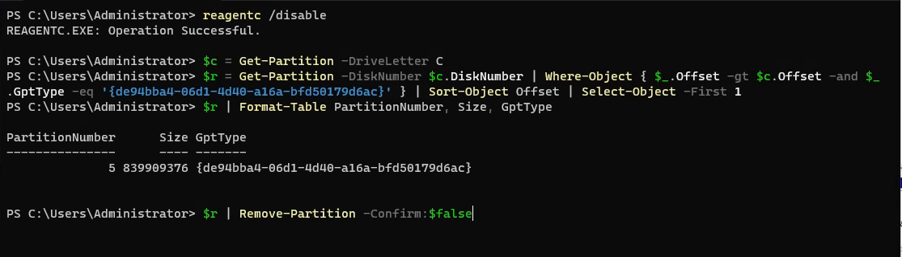

In Disk Management click **Action → Refresh**. The empty space is now directly to the right of C:.

### Step 7: make C: bigger

1. Right-click **C:** → **Extend Volume…** (no longer gray) → **Next**.

   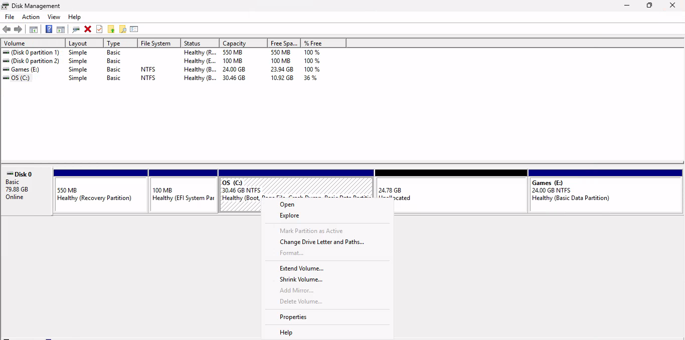

2. Look at *Maximum available space in MB*. At *Select the amount of space in MB*, type that number **minus 1024**. These 1024 MB stay free for the new Recovery partition in step 8. Example from our test: maximum 25377, typed **24353**. (Skipped step 6? Then keep the maximum.)

   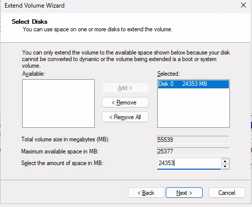

3. **Next** → **Finish**. C: grows straight away; no restart needed.

   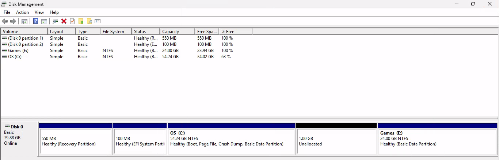

There's now a small black **1.00 GB Unallocated** block right of C:. Make sure it's the **only** black block on the disk before step 8.

### Step 8: put the Recovery partition back (paste block 2)

Skip this if you skipped step 6.

In **Terminal (Admin)** paste, then press **Enter** once more:

```
$c = Get-Partition -DriveLetter C
$p = New-Partition -DiskNumber $c.DiskNumber -UseMaximumSize -GptType '{de94bba4-06d1-4d40-a16a-bfd50179d6ac}'
Format-Volume -Partition $p -FileSystem NTFS -NewFileSystemLabel 'Windows RE tools' -Confirm:$false
"select disk $($c.DiskNumber)`nselect partition $($p.PartitionNumber)`ngpt attributes=0x8000000000000001`nexit" | diskpart
reagentc /enable
reagentc /info
```

It fills the 1 GB block with a new Recovery partition, marks it as a protected system partition, and switches the repair tools back on.

At the bottom you must see **Windows RE status: Enabled**:

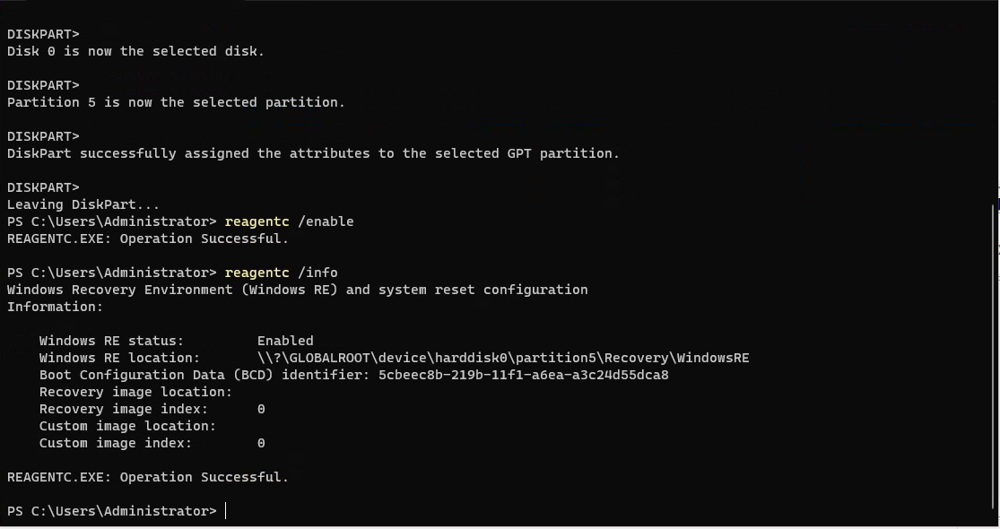

This follows Microsoft's own procedure for recreating the recovery partition ([KB5028997](https://support.microsoft.com/en-us/topic/kb5028997-instructions-to-manually-resize-your-partition-to-install-the-winre-update-400faa27-9343-461c-ada9-24c8229763bf)).

### Step 9: rename E: to D:

1. In Disk Management click **Action → Refresh**, then right-click **E:** → **Change Drive Letter and Paths…** → **Change…**

   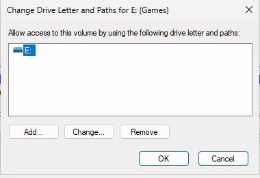

2. Choose **D** in the list → **OK** → **Yes** on the warning.

   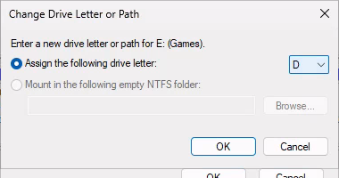

Done. The disk now looks like this: C: bigger, then Recovery, then your files on D::

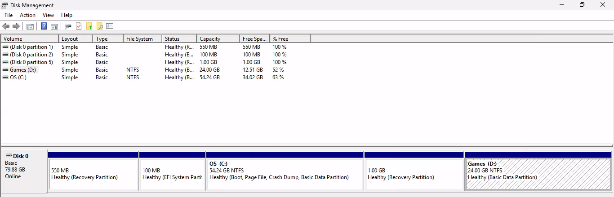

Because the drive is called D: again, every shortcut, Steam library and program that points at `D:\…` keeps working.

### Step 10: restart and check

1. Restart the PC.
2. Open File Explorer → *This PC*: C: shows the new size, D: has your files.
3. Start Steam (or your game launcher) and a game from D:. In our test Steam started from `D:\Steam` and found its library without any change:

   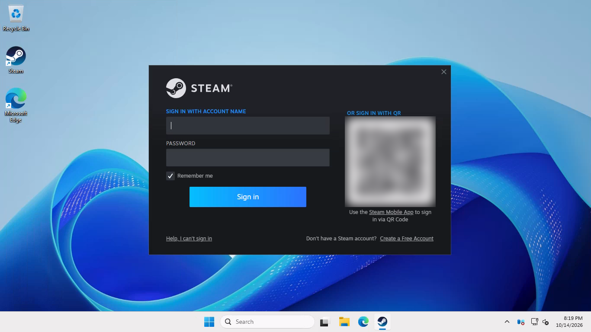

4. In **Terminal (Admin)** run `reagentc /info`. It must still say **Enabled**.
5. Put back what you turned off:
   - BitLocker: it resumes after the reboot, or click **Resume protection**. If D: was encrypted, turn BitLocker on for the new D:, because it's a new drive.
   - System Protection for D:, if you turned it off in step 2.
   - Services you set to *Manual* in Part 1.
   - OneDrive: start it again. If its folder was on D:, it may ask you to pick the folder again.
   - Backup programs that back up D:.

## If something goes wrong

| What you see | What to do |
|---|---|
| Shrink offers less than you need | Turn off System Protection for D: (step 2), close programs, try again. Windows can't move some files and keeps some overhead: in a test, a D: with 0.77 GB used could only shrink to 3.05 GB. |
| robocopy shows `ERROR 32` / FAILED above 0 | A program still has a file open. The error line names the file; Part 1 tells you how to find and close the program. Run the copy again. |
| Block 1 lists no partition | There's no Recovery partition after C:. Run `reagentc /enable`. In step 7 keep the maximum (no minus 1024) and skip step 8. |
| Extend Volume stays gray after step 6 | Click **Action → Refresh**. Still gray: something still sits between C: and the empty space. Compare with the pictures. |
| Block 2 says Enabled is missing / *Disabled* | Run `reagentc /enable` again. The repair image is still in `C:\Windows\System32\Recovery`, so Windows can always turn it back on. |
| After restart the PC asks for a BitLocker key | Enter the recovery key from https://aka.ms/myrecoverykey. Next time suspend protection first. |

## Other methods

**Method B: park the files on a USB disk.** For when D: is too full for the main method (U bigger than G). You need an external disk (here F:) with room for everything on D:.

1. Do Part 1, then copy D: to the USB disk: `robocopy D:\ F:\D-backup /MIR /COPYALL /DCOPY:DAT /R:1 /W:1 /XD "System Volume Information" "*RECYCLE.BIN" /NP /NFL /NDL`. FAILED must be 0.
2. Delete D: (step 5), then steps 6, 7 and 8. In step 7 choose how much C: grows, and leave the rest unallocated.
3. Right-click the remaining Unallocated block → **New Simple Volume…** → letter **D**, NTFS, same label.
4. Copy back: `robocopy F:\D-backup D:\ /MIR /COPYALL /DCOPY:DAT /R:1 /W:1 /NP /NFL /NDL`.
5. Step 10.

While you do this, the USB disk holds your only copy of D:. Keep a second backup.

**Method C: a partition tool that moves D:.** This is the "move the start of D:" idea: the tool slides D: to the right so the data never leaves it. Windows itself can't do this. Options: **GParted Live** (free, boot from USB: *Resize/Move* D: from the left, move the Recovery partition right, apply, back in Windows **Extend Volume** on C:), or commercial tools such as MiniTool Partition Wizard, AOMEI Partition Assistant or EaseUS Partition Master. Moving a partition's start rewrites all of its data in place; a power cut halfway can destroy D:. Back up first, and decrypt BitLocker drives first. Not tested here.

## Test evidence

The main method was run twice on 2026-10-14, each time with D: well filled and followed by a restart.

**Run 1: Windows Server 2025, done by hand through the screen (all pictures above).** A temporary VM with a Windows 11-style disk: Recovery 550 MB | EFI | C: 30.46 GB | Recovery 801 MB | D: "Games" 48 GB. D: held a Steam install and a test game: 9,762 files, 11.4 GB (about a quarter full), including hidden files and folders with custom permissions. Steam was running and the test game held its save file open. Server 2025 uses the same Disk Management, robocopy, reagentc and diskpart as Windows 11.

| Step | Result |
|---|---|
| Part 1 | While the game ran: Resource Monitor listed files on D:, the script said IN USE. The first robocopy gave `ERROR 32` on `slot1.sav` and FAILED 1. After closing the game and ending Steam in Task Manager (Steam Client Service stopped with it): Resource Monitor empty, script FREE. |
| 2–3 | Shrink by 24576 MB, new 24 GB volume E: "Games". |
| 4 | Second robocopy FAILED 0. D: and E: compared file by file (names, sizes, MD5 hash, permissions): 9,762 files, 12,246,992,450 bytes, identical. |
| 5–6 | Old D: deleted; block 1 disabled WinRE and removed the 801 MB Recovery partition after C:. The 550 MB one at the start was untouched. |
| 7 | Extend C: by 24353 MB: 30.46 → 54.24 GB, 1 GB left free. |
| 8 | Block 2 made a new Recovery partition; WinRE Enabled on it. |
| 9–10 | E: renamed to D: in the GUI. After restart: WinRE still Enabled, D: identical to before (same file-by-file fingerprint), Steam started from `D:\Steam\steam.exe`, the test game ran from D:. |

**Run 2: Windows Server 2022 (`pstest-01`), scripted.** D: 14 GB with 4.17 GB used (30%). The Disk Management clicks were done with the matching PowerShell commands (Resize-Partition, New-Partition, Remove-Partition, Set-Partition); robocopy and blocks 1 and 2 were exactly as above. With a file held open, the script said IN USE and robocopy failed with ERROR 32; after closing it, FREE and the copy completed (567 files). C: grew 44.24 → 53.24 GB. After restart WinRE was Enabled and D: was intact.

**Corrections to the first version of this guide (same date):**

- The robocopy command used `"$RECYCLE.BIN"`. In PowerShell (the default for Terminal on Windows 11) `$RECYCLE` is read as an empty variable, so the exclusion didn't work. Now `"*RECYCLE.BIN"`.
- The first version's test had D: only about 3% full (0.77 GB) and never had a program holding D:. Runs 1 and 2 above replace it.
- Block 1 and 2 replace hand-typed diskpart commands where you had to pick the partition number yourself.

**Not tested:** a physical Windows 11 PC, BitLocker, MBR disks, and the tools in method C.
